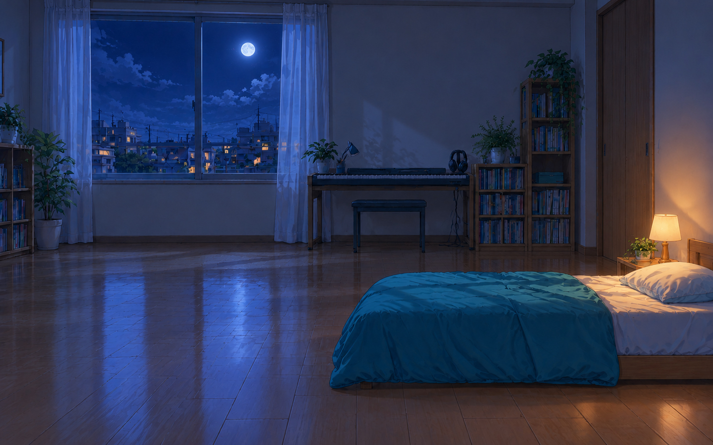

# Miku Desktop

[繁體中文](README.md) · **日本語** · [English](README.en.md)

macOS 向けの初音ミク・デスクトップコンパニオンです。動きのあるシーンや 3D キャラクターとのふれあい、ローカル AI によるチャットと記憶機能を備えています。

## 機能

- **シーンとライティング**：渋谷、池袋、秋葉原、新宿、学校の廊下、音楽室、ミクの部屋を収録しています。昼・夕方・夜はローカル時刻に合わせて滑らかに移り変わり、キャラクターへの光の当たり方もシーンや天気に応じて変化します。背景の選択、自動切り替え、切り替え間隔の設定が可能です。部屋は自動切り替えの対象外です。
- **動く背景**：雨、雪、霧、雷雨、日の出・日の入り、室内の光と影を表現します。対応する街中のシーンには車や JR の列車も登場します。省電力のため、動く演出を無効にすることもできます。
- **キャラクターとのふれあい**：マウスを近づける、頭をなでる、頬をつつく、手をつなぐ、ドラッグする、持ち上げる、手を離して着地させるといった操作ができます。チャットの返答には表情、動作、口の動きが連動します。ドラッグ後の位置に固定することも、再び自由に歩かせることもできます。
- **3 言語チャットと性格設定**：繁體中文、日本語、English に対応しています。元気、優しい、物静か、またはカスタムの性格と、ユーザーの呼び名を設定できます。返答には現地の日付と時刻が渡され、関連する初音ミクや楽曲の情報も付加されます。
- **画像理解**：画像を選択するか、チャットウインドウへドラッグ＆ドロップまたは貼り付けて送信できます。画像入力に対応したローカルモデルが必要です。
- **長期記憶**：会話、要約、好み、ふれあいの履歴、好感度、関係性の状態を保存します。覚えている内容は 1 件ずつ削除できます。記憶のリセットには 2 回の確認が必要で、復元可能なバックアップが 1 件残ります。
- **生活リズムと起床**：初期設定では 01:00〜07:00 に眠ります。「おやすみ」と伝えると早めに休み、チャットやふれあいで起こすことができます。眠るときは部屋に移動し、ベッドで横向きになって布団をかぶります。必要な素材がない場合は、立ったまま居眠りします。
- **選択式の自発的な声かけ**：使用中の App と生活リズム、Music／Spotify、YouTube／ニコニコの動画タイトル、定期的な画面理解を、それぞれ個別に有効化できます。4 項目はいずれも初期設定で無効です。
- **デスクトップ操作**：独立した「チャット／設定」フローティングボタン、メニューバー操作、透明部分でのマウス操作の透過、対応する Force Touch トラックパッドのフィードバック、ログイン時の起動に対応しています。ミクをクリックした場合はキャラクターとのふれあいだけが発生します。



## ビルドと起動

Apple シリコン搭載 Mac、macOS 13 以降、Swift 5.10 以降を含む Xcode Command Line Tools が必要です。ローカル AI サービスやモデルによっては、より新しいシステムや多くのメモリが必要になる場合があります。

```sh
git clone https://github.com/miku2339/miku_desktop.git
cd miku_desktop
./scripts/fetch-model.sh
./scripts/build-app.sh
```

`fetch-model.sh` はキャラクターモデルをダウンロードしてチェックサムを検証します。使用前に、モデルに同梱されている利用規約をお読みください。

リリースビルドの出力先は、**プロジェクトの 1 つ上の階層**にある `outputs/` です。

| ファイル | 用途 |
| --- | --- |
| `Miku Desktop.zip` | 展開後、App を「アプリケーション」フォルダに移して起動します |
| `Miku Desktop.app` | ローカルにある最新ビルドへのシンボリックリンクです |

起動後は、デスクトップの **チャット／設定** ボタン、またはメニューバーの **♪** を使用します。ローカルの壁紙サーバーを内蔵しているため、Plash は不要です。シーンとキャラクターはオフラインで動作します。チャットには別途ローカル AI サービスの起動が必要で、天気データの取得にはインターネット接続が必要です。

### 公開用パッケージと任意モデル

```sh
./scripts/build-app.sh --public
```

公開用パッケージとして `../outputs/Miku Desktop (Public).zip` が生成されます。任意の Tda モデルと GiGO 秋葉原の画像一式は含まれません。GiGO の画像がない場合、その秋葉原シーンはスキップされます。各素材には、それぞれのライセンスが適用されます。

Tda／金子卵黄によるクラシック衣装モデルを使用する場合は、[作者の配布ページ](https://bowlroll.net/file/16344)から `Tda式デフォ服ミク_ver1.1.zip` を入手し、同梱の利用規約を読んだうえで Python 3 を使ってインポートしてください。

```sh
python3 scripts/import-tda-model.py /path/to/Tda式デフォ服ミク_ver1.1.zip
./scripts/build-app.sh
```

インポートしていない場合は Animasa モデルが使用されます。Tda を含むローカルインストール用パッケージは個人利用に限ります。モデルとテクスチャはソースコードとともに配布されません。

## ローカル AI

1. [oMLX](https://github.com/jundot/omlx) をインストールして起動し、ローカルモデルを読み込みます。
2. **設定 → ローカル AI** に、エンドポイントとサービスが実際に提供しているモデル ID を入力します。
3. **接続テスト**を押してから、チャットを開きます。

初期設定のエンドポイントは `http://127.0.0.1:8000/v1`、モデル名は `Qwen3.5-0.8B-MLX-4bit` です。ローカルサービスに合わせて変更できます。言語モデルの重みは本アプリに含まれません。小規模モデルでは、知識、言語能力、性格設定に従う能力に限界があります。

エンドポイントにはループバックアドレスだけを指定できます。設定が oMLX と一致している場合、アプリは実行時に既存の API key を読み取り、プロジェクトには書き込みません。画像チャットと定期的な画面理解には、サービスと、現在読み込まれている変換済みモデルの両方が画像入力に対応している必要があります。テキスト専用モデルでは利用できません。

## データと権限

- 会話、記憶、チャット画像は `~/Library/Application Support/MikuDesktop/` に保存されます。性格や言語などの設定は macOS のユーザー設定に保存されます。
- リセットすると、会話、要約、覚えている内容、ふれあいの履歴、関係性データが消去されます。性格やその他の設定は保持されます。復元すると、リセット後に作られた新しい記憶はリセット前のバックアップで上書きされます。バックアップを完全に削除することもできます。
- チャット内容と、有効化した機能が取得した観察データはローカル AI に渡されます。定期的な画面キャプチャはファイルに保存されません。macOS 14 以降と画面収録の権限が必要です。音楽と動画の機能では、macOS のオートメーション権限が必要になる場合があります。
- 天気サービスは Open-Meteo に接続し、選択した都市の座標を使って天気を取得します。画面の観察と天気は別の機能です。

## 開発とコントリビューション

Swift のネイティブ UI は `Sources/MikuDesktop/`、キャラクター、背景、インタラクション用スクリプトは `Wallpaper/companion/`、シーン画像は `Wallpaper/assets/scenes/` にあります。

関連機能を変更した場合は、次のチェックを実行できます。JavaScript のテストには Node.js が必要です。

```sh
node --test Tests/*.test.mjs
./scripts/test-memory.sh
./scripts/test-relationship.sh
./scripts/test-awareness.sh
./scripts/test-sleep-schedule.sh
```

Issue や Pull Request を歓迎します。不具合を報告する際は、macOS のバージョン、再現手順、関連する画面を添えてください。ログを共有する前に、個人的な会話、API key、その他の個人情報を削除してください。

## 素材とライセンス

本プロジェクトは非公式のファン作品であり、Crypton Future Media、Project SEKAI、OTOIRO、JR East とは関係ありません。

ソースコードは [MIT License](LICENSE) の下で提供されます。キャラクター、MMD モデル、背景、サードパーティ製ライブラリには、それぞれのライセンスが適用されます。一部のアニメ調背景には、非商用に限る利用制限があります。東京および学校のシーンは、公式 MV の元映像ではありません。

出典と利用条件の詳細は、[THIRD_PARTY_NOTICES.md](THIRD_PARTY_NOTICES.md) および[シーン素材の説明](Wallpaper/assets/scenes/ATTRIBUTION.md)をご覧ください。
